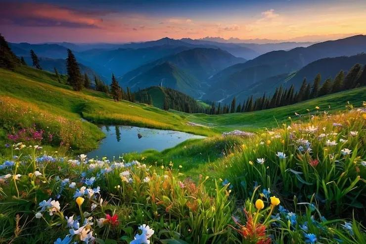
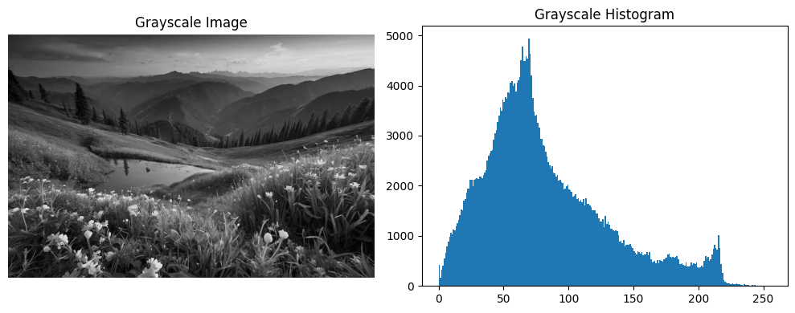
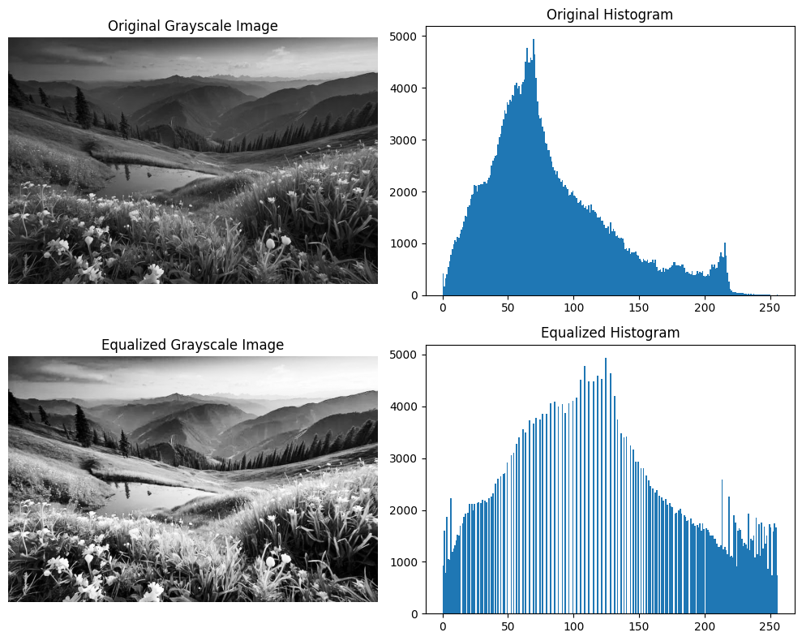
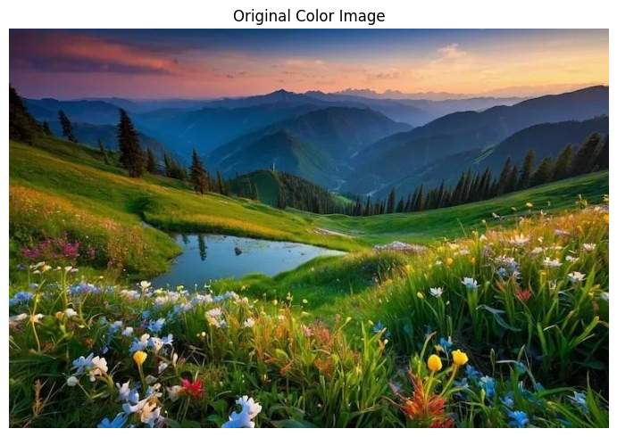
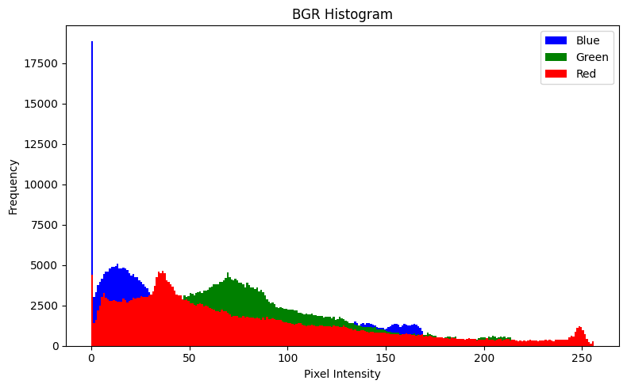
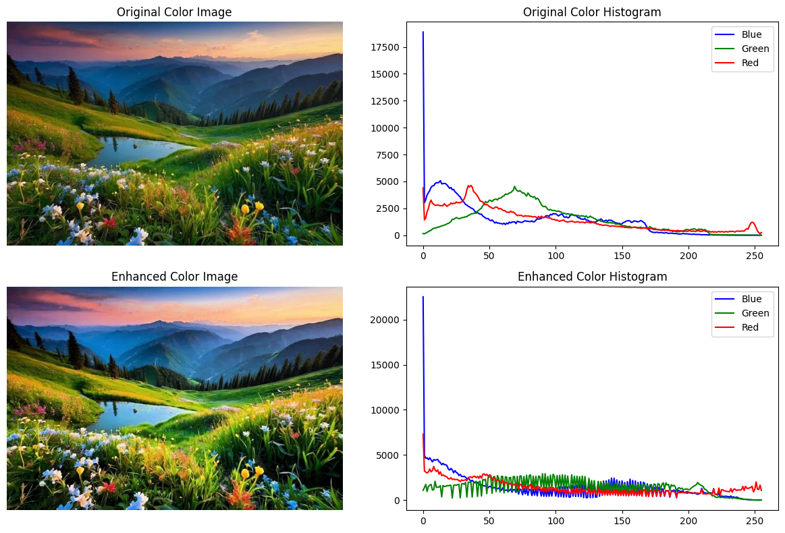

# Experiment 3: Histogram Equalization Using OpenCV (Grayscale & Color Images)

**Name:** Mithik jain G  
**Register Number:** 212224240087  

---

## Aim:
To write a Python program using OpenCV to perform histogram equalization on both grayscale and color images to enhance image contrast and brightness.

The program performs the following operations:
- Read and display a grayscale image
- Plot histogram of the grayscale image
- Apply histogram equalization on grayscale image
- Read and display a color image
- Plot histogram of B, G, R channels
- Convert image to HSV color space
- Apply histogram equalization on the Value (V) channel
- Convert the enhanced image back to BGR format
- Display original and enhanced images with histograms

---

## 🛠️ Software Used:
- **Anaconda** – Python 3.7+
- **Jupyter Notebook / VS Code**
- **OpenCV (`cv2`)**
- **NumPy**
- **Matplotlib (`matplotlib.pyplot`)**

---

## ⚙️ Algorithm:

- **Step 1:** Import the required libraries: OpenCV, NumPy, and Matplotlib.
- **Step 2:** Read the image (`n14.jpg` / `parrot.jpg`) in grayscale format using `cv2.imread(..., cv2.IMREAD_GRAYSCALE)`.
- **Step 3:** Display the grayscale image and plot its histogram using `plt.hist()`.
- **Step 4:** Apply histogram equalization using `cv2.equalizeHist()` to enhance contrast.
- **Step 5:** Display original grayscale image, its histogram, enhanced image, and its histogram using a $2 \times 2$ grid.
- **Step 6:** Read the same image in color format using `cv2.imread()`.
- **Step 7:** Split the image into B, G, R channels using `cv2.split()` and plot their histograms.
- **Step 8:** Convert the image from BGR to HSV color space using `cv2.cvtColor(img, cv2.COLOR_BGR2HSV)`.
- **Step 9:** Apply histogram equalization on the V (Value) channel using `cv2.equalizeHist()`.
- **Step 10:** Merge the channels using `cv2.merge()` and convert the image back to BGR format using `cv2.cvtColor(..., cv2.COLOR_HSV2BGR)`.
- **Step 11:** Display original color image, histogram, enhanced image, and enhanced histogram using a $2 \times 2$ grid.

---

## 💻 Program:

```python
# ==============================================================================
# Developed By: Mithik jain G
# Register No: 212224240087
# Experiment 3: Histogram Equalization Using OpenCV (Grayscale & Color Images)
# ==============================================================================
```

### Part A: Grayscale Histogram Equalization

#### Step 1: Import Required Libraries
```python
import cv2
import numpy as np
import matplotlib.pyplot as plt
```

#### Step 2: Read Grayscale Image
```python
# Read image in grayscale format
gray = cv2.imread('n14.jpg', cv2.IMREAD_GRAYSCALE)
```

#### Step 3: Display Grayscale Image and Plot its Histogram
```python
plt.figure(figsize=(10, 4))

plt.subplot(1, 2, 1)
plt.imshow(gray, cmap='gray')
plt.title('Grayscale Image')
plt.axis('off')

plt.subplot(1, 2, 2)
plt.hist(gray.ravel(), 256, [0, 256])
plt.title('Grayscale Histogram')

plt.show()
```

#### Step 4: Apply Histogram Equalization
```python
# Apply histogram equalization to enhance contrast
equalized = cv2.equalizeHist(gray)
```

#### Step 5: Display Original vs Equalized Grayscale Image with Histograms ($2 \times 2$ Grid)
```python
plt.figure(figsize=(10, 8))

plt.subplot(2, 2, 1)
plt.imshow(gray, cmap='gray')
plt.title('Original Grayscale Image')
plt.axis('off')

plt.subplot(2, 2, 2)
plt.hist(gray.ravel(), 256, [0, 256])
plt.title('Original Histogram')

plt.subplot(2, 2, 3)
plt.imshow(equalized, cmap='gray')
plt.title('Equalized Grayscale Image')
plt.axis('off')

plt.subplot(2, 2, 4)
plt.hist(equalized.ravel(), 256, [0, 256])
plt.title('Equalized Histogram')

plt.tight_layout()
plt.show()
```

---

### Part B: Color Image Histogram Equalization

#### Step 6: Read Color Image
```python
# Read color image
img = cv2.imread('n14.jpg')

plt.imshow(cv2.cvtColor(img, cv2.COLOR_BGR2RGB))
plt.title('Original Color Image')
plt.axis('off')
plt.show()
```

#### Step 7: Split B, G, R Channels and Plot Histograms
```python
b, g, r = cv2.split(img)

plt.figure(figsize=(8, 5))

plt.hist(b.ravel(), 256, [0, 256], color='blue', label='Blue')
plt.hist(g.ravel(), 256, [0, 256], color='green', label='Green')
plt.hist(r.ravel(), 256, [0, 256], color='red', label='Red')

plt.title('BGR Histogram')
plt.xlabel('Pixel Intensity')
plt.ylabel('Frequency')
plt.legend()
plt.show()
```

#### Step 8 & 9: Convert to HSV and Equalize V (Value) Channel
```python
# Convert image from BGR to HSV
hsv = cv2.cvtColor(img, cv2.COLOR_BGR2HSV)
h, s, v = cv2.split(hsv)

# Equalize V (Value) channel
v_equalized = cv2.equalizeHist(v)
```

#### Step 10: Merge Channels and Convert Back to BGR
```python
# Merge back and convert to BGR
hsv_equalized = cv2.merge((h, s, v_equalized))
enhanced = cv2.cvtColor(hsv_equalized, cv2.COLOR_HSV2BGR)
```

#### Step 11: Display Original vs Enhanced Color Image with Histograms ($2 \times 2$ Grid)
```python
plt.figure(figsize=(12, 8))

plt.subplot(2, 2, 1)
plt.imshow(cv2.cvtColor(img, cv2.COLOR_BGR2RGB))
plt.title('Original Color Image')
plt.axis('off')

plt.subplot(2, 2, 2)
for channel, color, name in zip(cv2.split(img),
                                 ['blue', 'green', 'red'],
                                 ['Blue', 'Green', 'Red']):
    hist = cv2.calcHist([img], [['Blue', 'Green', 'Red'].index(name)],
                        None, [256], [0, 256])
    plt.plot(hist, color=color, label=name)

plt.title('Original Color Histogram')
plt.legend()

plt.subplot(2, 2, 3)
plt.imshow(cv2.cvtColor(enhanced, cv2.COLOR_BGR2RGB))
plt.title('Enhanced Color Image')
plt.axis('off')

plt.subplot(2, 2, 4)
for i, color in enumerate(['blue', 'green', 'red']):
    hist = cv2.calcHist([enhanced], [i], None, [256], [0, 256])
    plt.plot(hist, color=color, label=color.capitalize())

plt.title('Enhanced Color Histogram')
plt.legend()

plt.tight_layout()
plt.show()
```

---

## Output:

### Input Image:


---

### Grayscale Histogram Equalization

#### Step 3: Grayscale Image & Histogram


#### Step 5: Original vs Equalized Grayscale Image with Histograms ($2 \times 2$ Grid)
- Original grayscale image is displayed.
- Histogram of original grayscale image is plotted.
- Enhanced image after histogram equalization is displayed.
- Histogram of enhanced grayscale image shows improved contrast and spread-out pixel values.



---

### Color Image Histogram Equalization

#### Step 6: Original Color Image


#### Step 7: Histogram of B, G, R Channels


#### Step 11: Original vs Enhanced Color Image with Histograms ($2 \times 2$ Grid)
- Original color image is displayed.
- Histogram of B, G, R channels is plotted.
- Enhanced image after HSV-based equalization on the Value (V) channel is displayed.
- Histogram of enhanced image shows improved intensity distribution across all color channels.



---

## Result:
Thus, histogram equalization is successfully performed on both grayscale and color images using OpenCV. The contrast and brightness of the images are significantly improved, enhancing visual quality and feature visibility.
